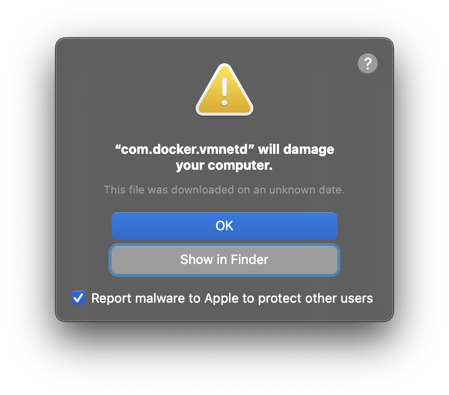
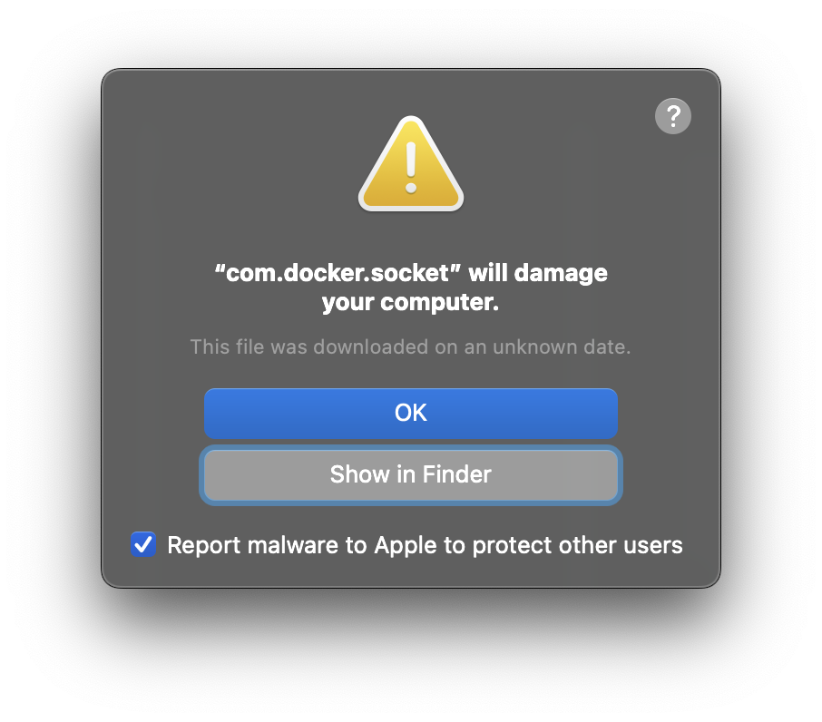

<!-- START doctoc generated TOC please keep comment here to allow auto update -->
<!-- DON'T EDIT THIS SECTION, INSTEAD RE-RUN doctoc TO UPDATE -->

- [troubleshooting](#troubleshooting)
  - [`permission denied while trying to connect to the Docker daemon socket`](#permission-denied-while-trying-to-connect-to-the-docker-daemon-socket)
  - [Malware Blocked - 'com.docker.vmnetd'](#malware-blocked---comdockervmnetd)
  - [Docker 自定义网桥网络超时问题](#docker-%E8%87%AA%E5%AE%9A%E4%B9%89%E7%BD%91%E6%A1%A5%E7%BD%91%E7%BB%9C%E8%B6%85%E6%97%B6%E9%97%AE%E9%A2%98)

<!-- END doctoc generated TOC please keep comment here to allow auto update -->

> [!NOTE|label:references:]
> - [Troubleshoot topics for Docker Desktop](https://docs.docker.com/desktop/troubleshoot-and-support/troubleshoot/topics/)
> - [Troubleshoot Docker Desktop](https://docs.docker.com/desktop/troubleshoot-and-support/troubleshoot/)
> - osx:
>   - [Incompatible CPU detected](https://docs.docker.com/desktop/troubleshoot-and-support/troubleshoot/topics/#incompatible-cpu-detected)
>   - [VPNKit keeps breaking](https://docs.docker.com/desktop/troubleshoot-and-support/troubleshoot/topics/#vpnkit-keeps-breaking)
> - [windows](https://docs.docker.com/desktop/troubleshoot-and-support/troubleshoot/topics/#topics-for-windows)

## troubleshooting

```bash
# -- osx --
$ /Applications/Docker.app/Contents/MacOS/com.docker.diagnose
# create and upload the diagnostics id
$ /Applications/Docker.app/Contents/MacOS/com.docker.diagnose gather -upload
# self diagnose
$ /Applications/Docker.app/Contents/MacOS/com.docker.diagnose check
# check log
$ pred='process matches ".*(ocker|vpnkit).*" || (process in {"taskgated-helper", "launchservicesd", "kernel"} && eventMessage contains[c] "docker")'
$ /usr/bin/log stream --style syslog --level=debug --color=always --predicate "$pred"

# -- linux --
$ /opt/docker-desktop/bin/com.docker.diagnose
# create and upload the diagnostics id
$ /opt/docker-desktop/bin/com.docker.diagnose gather -upload
# self diagnose
$ /opt/docker-desktop/bin/com.docker.diagnose check
# check log
$ journalctl --user --unit=docker-desktop

# -- windows --
> C:\Program Files\Docker\Docker\resources\com.docker.diagnose.exe
# create and upload the diagnostics id
> & "C:\Program Files\Docker\Docker\resources\com.docker.diagnose.exe" gather -upload
> Expand-Archive -LiteralPath "%TEMP%\5DE9978A-3848-429E-8776-950FC869186F\20230607101602.zip" -DestinationPath "%TEMP%\5DE9978A-3848-429E-8776-950FC869186F\20230607101602"
# self diagnose
> & "C:\Program Files\Docker\Docker\resources\com.docker.diagnose.exe" check
# check log
> code $Env:LOCALAPPDATA\Docker\log
```

### `permission denied while trying to connect to the Docker daemon socket`

> [!NOTE|label:see also:]
> - [* imarslo: linux/system/change group](../../linux/system.html#modify-group)

- issue shows even if the account exists in `docker` group
  ```bash
  # account already been added in `docker` group
  $ id marslo
  uid=1100(marslo) gid=1100(marslo) groups=1100(marslo),994(docker)
  $ docker ps
  permission denied while trying to connect to the Docker daemon socket at unix:///var/run/docker.sock: Get "http://%2Fvar%2Frun%2Fdocker.sock/v1.44/containers/json": dial unix /var/run/docker.sock: connect: permission denied

  # group info
  $ getent group docker
  docker:x:994:devops,marslo
  $ getent group 994
  docker:x:994:devops,marslo

  # remote
  $ sudo gpasswd -d marslo docker
  Removing user marslo from group docker
  $ id marslo
  uid=1100(marslo) gid=1100(marslo) groups=1100(marslo)

  # re-added
  $ sudo usermod -aG docker marslo
  $ id marslo
  uid=1100(marslo) gid=1100(marslo) groups=1100(marslo),994(docker)
  $ docker ps
  permission denied while trying to connect to the Docker daemon socket at unix:///var/run/docker.sock: Get "http://%2Fvar%2Frun%2Fdocker.sock/v1.44/containers/json": dial unix /var/run/docker.sock: connect: permission denied
  ```

- root cause
  ```bash
  # docker group-id was 990, and it was changed to 994; but the `/var/run/docker.sock` wasn't been changed
  $ ls -asltrh /var/run/docker.sock
  0 srw-rw---- 1 root redwillow 0 Mar  7 15:27 /var/run/docker.sock
  ```

- solution
  ```bash
  $ sudo chown -R root:docker /var/run/docker.sock
  $ docker ps
  CONTAINER ID   IMAGE     COMMAND   CREATED   STATUS    PORTS     NAMES

  # to change all after GID changed
  $ find / -gid OLD_GID ! -type l -exec chgrp NEW_GID {} \;
  ```

### Malware Blocked - 'com.docker.vmnetd'

> [!NOTE|label:references:]
> - [#7520 - [Workaround in description] Mac is detecting Docker as a malware and keeping it from starting](https://github.com/docker/for-mac/issues/7520)
> - [Malware Blocked: “com.docker.vmnetd” was not opened because it contains malware](https://forums.docker.com/t/malware-blocked-com-docker-vmnetd-was-not-opened-because-it-contains-malware/145930)
> - [Incident Update: Docker Desktop for Mac](https://www.docker.com/blog/incident-update-docker-desktop-for-mac/)




- status
  ```bash
  $ sha256sum /Library/PrivilegedHelperTools/com.docker.vmnetd
  bed1a0468de21d1189ab560fbfcd3432b396143c067831e096553057401fac67  /Library/PrivilegedHelperTools/com.docker.vmnetd
  ```

- workaround
  ```bash
  #!/bin/bash

  # Stop the docker services
  echo "Stopping Docker..."
  sudo pkill '[dD]ocker'

  # Stop the vmnetd service
  echo "Stopping com.docker.vmnetd service..."
  sudo launchctl bootout system /Library/LaunchDaemons/com.docker.vmnetd.plist

  # Stop the socket service
  echo "Stopping com.docker.socket service..."
  sudo launchctl bootout system /Library/LaunchDaemons/com.docker.socket.plist

  # Remove vmnetd binary
  echo "Removing com.docker.vmnetd binary..."
  sudo rm -f /Library/PrivilegedHelperTools/com.docker.vmnetd

  # Remove socket binary
  echo "Removing com.docker.socket binary..."
  sudo rm -f /Library/PrivilegedHelperTools/com.docker.socket

  # Install new binaries
  echo "Install new binaries..."
  sudo cp /Applications/Docker.app/Contents/Library/LaunchServices/com.docker.vmnetd /Library/PrivilegedHelperTools/
  sudo cp /Applications/Docker.app/Contents/MacOS/com.docker.socket /Library/PrivilegedHelperTools/
  ```

  - result
    ```bash
    $ sudo sha256sum /Library/PrivilegedHelperTools/com.docker.*
    ec9c5cbef5bf903e17569393cabe452499370b5ec89bdd819054806e20a0dca1  /Library/PrivilegedHelperTools/com.docker.socket
    be868fea1cf597f45ecc1892564ccac333c79c94d0c49f26c28fc7931bede017  /Library/PrivilegedHelperTools/com.docker.vmnetd
    ```

- solution

  > [!NOTE|label:references:]
  > - [Uninstall Docker Desktop](https://docs.docker.com/desktop/uninstall/)

  - remove docker desktop
    ```bash
    $ /Applications/Docker.app/Contents/MacOS/uninstall
    Password:
    Uninstalling Docker Desktop...
    Error: unlinkat /Users/<USER_HOME>/Library/Containers/com.docker.docker/.com.apple.containermanagerd.metadata.plist: operation not permitted

    $ rm -rf ~/Library/Group\ Containers/group.com.docker
    $ rm -rf ~/.docker
    ```

  - re-install docker desktop
    ```bash
    $ sudo hdiutil attach Docker.dmg
    $ sudo /Volumes/Docker/Docker.app/Contents/MacOS/install
    $ sudo hdiutil detach /Volumes/Docker
    ```

### Docker 自定义网桥网络超时问题

1. 错误是什么

  在 Ubuntu 18.04 宿主机上，使用 Snap 安装的 Docker 环境中出现了网络路由黑洞。具体表现为：

  - Docker 默认网桥 (`docker0`) 的流量转发正常。
  - 新建的用户自定义网桥 (`tasktracker-net` / `br-6e0f5168bf60`) 流量全部超时(包括容器间 TCP 通信和宿主机外部对映射端口的访问)。
  - 数据包在完成目标地址转换 (DNAT) 后神秘消失，宿主机的 `iptables-legacy` 计数器(如 `FORWARD` 或 `DOCKER-USER` 链)中完全没有显示这些被丢弃的数据包(计数器为 0)。

2. 发现错误的日志与命令

  为了绕过宿主机的默认视图，探查 `Snap` 容器内部的防火墙后端状态，执行了以下针对 `nftables` 的检查命令：

  <!--sec data-title="commands and logs" data-id="section0" data-show=true data-collapse=true ces-->

  ```bash
  # 查看 Snap 环境内的 filter 表
  $ sudo snap run --shell docker.dockerd -c 'nft list table ip filter'
  # Warning: table ip filter is managed by iptables-nft, do not touch!
  table ip filter {
    chain DOCKER {
      ip daddr 172.17.0.2 iifname != "docker0" oifname "docker0" tcp dport 27017 counter packets 592931 bytes 35613020 accept
      iifname != "docker0" oifname "docker0" counter packets 23 bytes 1424 drop
    }

    chain DOCKER-FORWARD {
      counter packets 348785704 bytes 616495013957 jump DOCKER-CT
      counter packets 139496141 bytes 596480076918 jump DOCKER-ISOLATION-STAGE-1
      counter packets 139496141 bytes 596480076918 jump DOCKER-BRIDGE
      iifname "docker0" counter packets 138903004 bytes 596444451326 accept
    }

    chain DOCKER-BRIDGE {
      oifname "docker0" counter packets 592954 bytes 35614444 jump DOCKER
    }

    chain DOCKER-CT {
      oifname "docker0" ct state related,established counter packets 209289563 bytes 20014937039 accept
    }

    chain DOCKER-ISOLATION-STAGE-1 {
      iifname "docker0" oifname != "docker0" counter packets 138903004 bytes 596444451326 jump DOCKER-ISOLATION-STAGE-2
    }

    chain DOCKER-ISOLATION-STAGE-2 {
      oifname "docker0" counter packets 0 bytes 0 drop
    }

    chain FORWARD {
      type filter hook forward priority filter; policy drop;
      counter packets 348785704 bytes 616495013957 jump DOCKER-USER
      counter packets 348785704 bytes 616495013957 jump DOCKER-FORWARD
    }

    chain DOCKER-USER {
    }
  }

  # 查看 Snap 环境内的 nat 表
  $ sudo snap run --shell docker.dockerd -c 'nft list table ip nat'
  # Warning: table ip nat is managed by iptables-nft, do not touch!
  table ip nat {
    chain DOCKER {
      iifname "docker0" counter packets 0 bytes 0 return
      iifname != "docker0" tcp dport 27017 counter packets 7634 bytes 451872 dnat to 172.17.0.2:27017
    }

    chain PREROUTING {
      type nat hook prerouting priority dstnat; policy accept;
      fib daddr type local counter packets 136619 bytes 7972065 jump DOCKER
    }

    chain OUTPUT {
      type nat hook output priority dstnat; policy accept;
      ip daddr != 127.0.0.0/8 fib daddr type local counter packets 0 bytes 0 jump DOCKER
    }

    chain POSTROUTING {
      type nat hook postrouting priority srcnat; policy accept;
      ip saddr 172.17.0.0/16 oifname != "docker0" counter packets 0 bytes 0 masquerade
    }
  }

  # 查看 Snap 环境内的 raw 表
  $ sudo snap run --shell docker.dockerd -c 'nft list table ip raw'
  table ip raw {
    chain PREROUTING {
      type filter hook prerouting priority raw; policy accept;
      ip daddr 172.17.0.2 iifname != "docker0" counter packets 0 bytes 0 drop
    }
  }

  $ sudo snap run --shell docker.dockerd -c 'nft list chain ip filter FORWARD; nft list chain ip filter DOCKER'
  table ip filter {
    chain FORWARD {
      type filter hook forward priority filter; policy drop;
      counter packets 348785885 bytes 616495044491 jump DOCKER-USER
      counter packets 348785885 bytes 616495044491 jump DOCKER-FORWARD
    }
  }
  table ip filter {
    chain DOCKER {
      ip daddr 172.17.0.2 iifname != "docker0" oifname "docker0" tcp dport 27017 counter packets 592931 bytes 35613020 accept
      iifname != "docker0" oifname "docker0" counter packets 23 bytes 1424 drop
    }
  }
  ```

  <!--endsec-->

3. 从 Output 中发现了什么问题

  通过上述命令的输出，发现了一个典型的防火墙“脑裂”(Split-Brain)冲突：

  - 双后端并行处理：宿主机 (Ubuntu 18.04) 原生使用 `iptables-legacy`，而 Snap 版 Docker (基于 Ubuntu Core 24) 启用了自带的 `iptables-nft` (nftables)。Linux 内核会同时处理这两套钩子 (hooks)。
  - 苛刻的默认丢弃策略：在 `nftables` 的输出中，`FORWARD` 链的默认策略被设为了丢弃(`policy drop`)。
  - 规则只对 docker0 生效：`nftables` 的规则中，只有针对 `docker0` 的显式放行规则(`iifname != "docker0" oifname "docker0" ... accept`)，完全没有关于自定义网桥 `br-6e0f5168bf60` 的放行配置。
  - 规则写入错位：当创建自定义网桥时，Docker 守护进程被双重防火墙后端混淆，把新网桥的放行规则写到了宿主机的 `legacy iptables` 中，却遗漏了 Snap 内部的 `nftables`。

  结论：当自定义网桥的数据包到达时，它首先命中了 Snap 环境中 nftables 缺省的 DROP 策略并被静默丢弃。数据包根本没有机会到达 legacy iptables 进行规则匹配，这也是为什么 legacy 侧的抓包和计数器完全捕获不到任何丢包痕迹。

4. 如何 Fix

  > [!NOTE|labels:关于以后会不会再出现]
  > - 为什么会有两套规则： 很可能是 snap 版 Docker 某次自动更新后，使用的 iptables 后端从 nft 换成了 legacy，旧的 nft 规则就一直留在内核里。
  > - 重启 server 也会清掉： nft 规则存在内存里，不会保存到磁盘。
  > - 以后的检查： snap 版 Docker 再次自动更新或者重启后，执行一次 sudo snap run --shell docker.dockerd -c 'nft list tables'。如果又出现了这几张表，说明 Docker 在两个后端之间来回切换，需要固定 snap 版本，或者调整它使用的 iptables 后端。第 1 步里 iptables --version 的输出会显示现在用的是 (legacy) 还是 (nf_tables)。

  立即修复方案(清理并重建规则)<br>
  需要清空双侧发生冲突的规则集，并强制 Docker 重新生成一致的防火墙规则：

  - 检查:

    ```bash
    # 确认 legacy 规则能单独支撑
    sudo iptables -t nat -S | grep -E '27017|27018|MASQUERADE'; sudo iptables -S DOCKER

    #  检查 IPv6 的两张表，以及现在 Docker 用的是哪种 iptables
    sudo snap run --shell docker.dockerd -c 'nft list table ip6 filter; nft list table ip6 nat; command -v iptables; iptables --version'
    ```

  - 清空 `nftables` 规则集(移除 Snap 环境中 `FORWARD` 链上的 `policy drop`)：
    ```bash
    # 备份完整的 nft 规则
    sudo snap run --shell docker.dockerd -c 'nft list ruleset' > ~/nft-ruleset-backup-$( date +%Y%m%d-%H%M%S ).nft && ls -l ~/nft-ruleset-backup-*.nft
    # 从备份恢复 (以防万一)
    sudo snap run --shell docker.dockerd -c 'nft -f /path/to/<备份文件名>.nft'

    # clear
    sudo snap run --shell docker.dockerd -c 'nft flush ruleset'
    ```

  - 清空 `legacy iptables` 规则集 (OPTIONAL)：
    ```bash
    sudo iptables -F
    sudo iptables -t nat -F
    sudo iptables -t raw -F
    ```

  - 重启 Docker 服务 (OPTIONAL)：
    ```bash
    sudo systemctl restart snap.docker.dockerd.service
    ```
